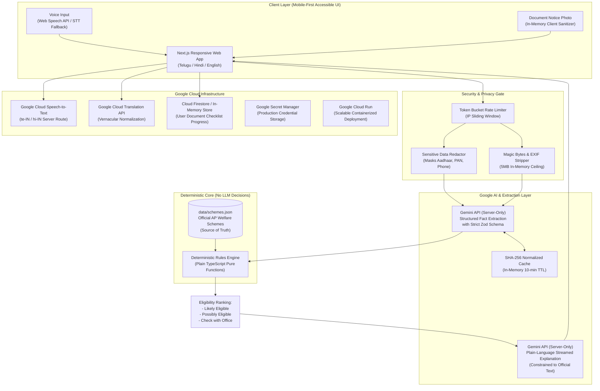

# SevaSetu (సేవాసేతు) — A Bridge to Public Services

> **Civic Tech Platform for Inclusive Welfare Access in Andhra Pradesh**  
> *Turning complex government schemes into personal checklists and pre-filled draft applications in under 5 minutes.*

[](https://www.typescriptlang.org/)
[](https://nextjs.org/)
[](https://www.w3.org/WAI/standards-guidelines/wcag/)
[](./SECURITY.md)

---

## 1. Problem Statement & Impact

### The Problem
Millions of eligible citizens across Andhra Pradesh—particularly rural farmers, artisans, widows, and low-literacy residents who speak Telugu or Hindi—miss life-changing government welfare benefits. The barriers are daunting:
1. **Intimidating English forms & legalese**: Guidelines are published as lengthy, bureaucratic PDF Government Orders (G.O.s).
2. **Ambiguous eligibility**: Citizens travel to administrative offices without knowing if their age, land holding, or income qualifies.
3. **Missing document rejections**: Citizens wait hours in line at Grama/Ward Sachivalayams only to be turned away because a specific document was missing.

### The Solution: SevaSetu
SevaSetu breaks down these barriers through a **voice-first, multilingual, mobile web application**:
- Citizens speak or type in **Telugu (తెలుగు)**, **Hindi (हिंदी)**, or **English**, or upload a photo of a notice.
- **Gemini API** extracts structured facts with a confidence score and asks one targeted follow-up question if a critical detail is missing.
- A **deterministic rules engine (pure TypeScript, zero LLM guesswork)** evaluates eligibility criteria against official government schemes.
- Citizens leave with a **plain-language explanation**, an **interactive document checklist**, and a **pre-filled downloadable draft application (`.txt`)** ready to take to the village office.

---

## 2. Architecture Diagram



---

## 3. Google Services Used & Why

Each Google service was chosen specifically to eliminate a concrete barrier for low-literacy citizens:

| Google Service | Architectural Role | How it Directly Empowers the Citizen |
| :--- | :--- | :--- |
| **1. Gemini API (`@google/genai`)** | Server-side structured extraction & plain-language explanations | Converts conversational, colloquial Telugu/Hindi descriptions into structured facts, and writes empathetic, 6th-grade level explanations using *only* official scheme data. |
| **2. Google Cloud Speech-to-Text** | Audio transcription endpoint (`te-IN`, `hi-IN`) | Enables citizens who cannot read or write English or type comfortably on touchscreens to describe their circumstances by voice. Includes automatic browser fallback. |
| **3. Google Cloud Translation API** | Vernacular text translation & normalization | Accurately translates citizen queries in rural dialects to canonical terms for scheme evaluation while returning output in their native tongue. |
| **4. Google Cloud Firestore** | User checklist persistence with `firestore.rules` | Allows a citizen to save their verified document progress securely and resume on any device. Uses isolated per-user collections and includes an in-memory fallback. |
| **5. Google Cloud Run** | Zero-downtime serverless containerization (`Dockerfile`) | Scales down to zero cost during idle hours and scales up instantaneously to handle citizen traffic spikes during welfare disbursement cycles. |
| **6. Google Secret Manager** | Secure production credential & API key management | Guarantees that `GEMINI_API_KEY` and service account keys are stored securely, never exposed in client bundles or code commits. |

---

## 4. Quick Start & Setup

### Prerequisites
- Node.js 20+ or 22+
- npm 10+ or 11+

### Installation & Run (One Documented Command)
```bash
npm install && npm run dev
```
Open [http://localhost:3000](http://localhost:3000) in your browser.

### Running with Production Build
```bash
npm run build && npm start
```

---

## 5. Environment Variables Configuration

Copy `.env.example` to `.env.local` to configure optional production keys:

```bash
cp .env.example .env.local
```

| Variable | Description | Default / Example | Required? |
| :--- | :--- | :--- | :--- |
| `GEMINI_API_KEY` | Google Gemini API key | `AIzaSy...` | Optional (heuristic fallback included) |
| `GEMINI_MODEL` | Gemini model name | `gemini-2.5-flash` | Optional |
| `ENABLE_SPEECH_TO_TEXT` | Enable Google Cloud STT server route | `false` | Optional (browser speech API is primary) |
| `ENABLE_TRANSLATION` | Enable Google Cloud Translation route | `false` | Optional |
| `ENABLE_FIRESTORE` | Enable Cloud Firestore persistence | `false` | Optional (in-memory store fallback active) |
| `GOOGLE_CLOUD_PROJECT` | GCP Project ID | `sevasetu-demo` | Optional |
| `PORT` | Local server port | `3000` | Optional |

> **Note**: SevaSetu runs **100% green out of the box with zero API keys set** thanks to intelligent deterministic heuristic fallbacks and mock-safe test architecture.

---

## 6. Two-Minute Demo Script (in Telugu & Hindi)

### 2-Minute Demo Flow (Telugu - తెలుగు)
1. **మొదటి నిమిషం (0:00 - 1:00) — వాయిస్ ఇన్‌పుట్ & వివరాల సేకరణ**:
   - హోమ్‌పేజీ ఓపెన్ చేయండి. డిఫాల్ట్‌గా తెలుగు భాష కనిపిస్తుంది.
   - "తెలుగులో మాట్లాడండి" (🎙️) బటన్ క్లిక్ చేయండి లేదా క్విక్ ప్రొఫైల్ "🌾 Small Farmer" ఎంచుకోండి:
     > *"నేను గుంటూరు జిల్లాలో నివసిస్తున్న 56 ఏళ్ల రైతును. నాకు 2.5 ఎకరాల పొలం మరియు తెల్ల రేషన్ కార్డు ఉన్నాయి."*
   - "అర్హత ఉన్న పథకాలను కనుగొనండి" క్లిక్ చేయండి.
   - **దశ 2 (వివరాల పరిశీలన)**: కంప్యూటర్ గుర్తించిన వివరాలు కనిపిస్తాయి (వయస్సు: 56, వృత్తి: రైతు, భూమి: 2.5 ఎకరాలు). "ధృవీకరించి పథకాలను చూడండి" క్లిక్ చేయండి.

2. **రెండవ నిమిషం (1:00 - 2:00) — నిబంధనల లెక్కింపు, చెక్‌లిస్ట్ & దరఖాస్తు డౌన్‌లోడ్**:
   - **దశ 3 (ఫలితాలు)**: "వైఎస్సార్ రైతు భరోసా" మొదటి స్థానంలో "అర్హత ఉండే అవకాశం ఎక్కువ" బ్యాడ్జితో కనిపిస్తుంది.
   - అధికారిక వెబ్‌సైట్ లింక్ (`ysrrythubharosa.ap.gov.in`) మరియు ధృవీకరణ హెచ్చరికను పరిశీలించండి.
   - "పత్రాల జాబితా & దరఖాస్తు చూడండి" క్లిక్ చేయండి. మోడల్ ఓపెన్ అవుతుంది:
     - జెమిని అందించిన సరళమైన వివరణను చదవండి.
     - ఆధార్ కార్డు, పట్టాదారు పాస్‌బుక్ పక్కన ఉన్న చెక్‌బాక్సులను ఎంచుకోండి.
     - పేరు ("కోటేశ్వరరావు") నమోదు చేసి **"ముందస్తు దరఖాస్తు ముసాయిదా డౌన్‌లోడ్ (.txt)"** క్లిక్ చేయండి.
     - డౌన్‌లోడ్ అయిన టెక్స్ట్ ఫైల్‌ను గ్రామ సచివాలయానికి తీసుకెళ్లవచ్చని చూపించండి!

### 2-Minute Demo Flow (Hindi - हिंदी)
1. भाषा को "हिंदी" पर स्विच करें।
2. किसान का विवरण बोलें या चुनें:
   > *"मैं गुंटूर आंध्र प्रदेश का 56 वर्षीय किसान हूँ। मेरे पास 2.5 एकड़ जमीन और सफेद राशन कार्ड है।"*
3. "पात्र योजनाएं खोजें" पर क्लिक करें -> विवरणों की पुष्टि करें।
4. रायथू भरोसा योजना पर "भरा हुआ ड्राफ्ट आवेदन डाउनलोड करें" पर क्लिक करके तुरंत `.txt` फाइल डाउनलोड करें।

---

## 7. Scheme Data Verification Status

All welfare schemes in `data/schemes.json` are initialised with `data_status: "UNVERIFIED"` in accordance with strict hackathon transparency rules. Whenever any scheme is unverified, the app renders a high-visibility amber banner:
> **"Scheme details are being verified. Confirm with the office before applying."**

### Fields Requiring Human Audit Before Official Demo:
Refer to [data/VERIFICATION_CHECKLIST.md](./data/VERIFICATION_CHECKLIST.md) for full step-by-step audit steps:
1. **YSR Rythu Bharosa**: Verify annual DBT tranche sum (₹13,500) and tenant farmer CCRC requirements against latest 2025-26 Agriculture Department G.O.
2. **YSR Pension Kanuka**: Confirm cutoff age (60 years) and disability pension SADAREM certificate threshold (40%).
3. **Dr. YSR Aarogyasri**: Verify enhanced ceiling of ₹25,00,000 across network hospitals.
4. **YSR Cheyutha**: Confirm woman entrepreneur age bracket (45 to 60 years) and BC/SC/ST/Minority quota.
5. **YSR Netanna Nestham**: Verify handloom geo-tagging guidelines.
6. **Jagananna Ammavodi**: Verify 75% minimum school attendance condition.
